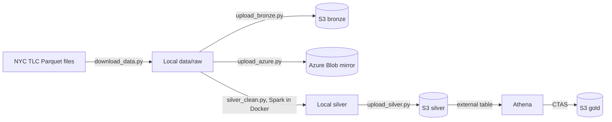
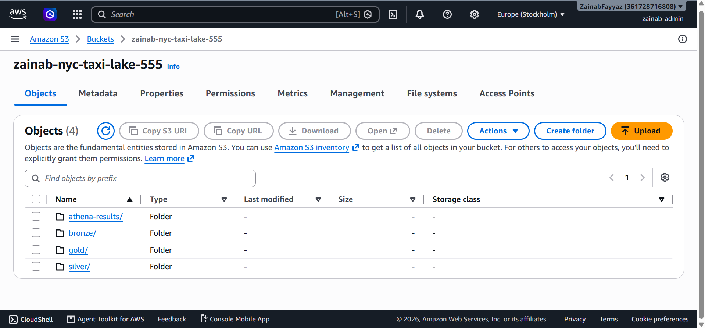
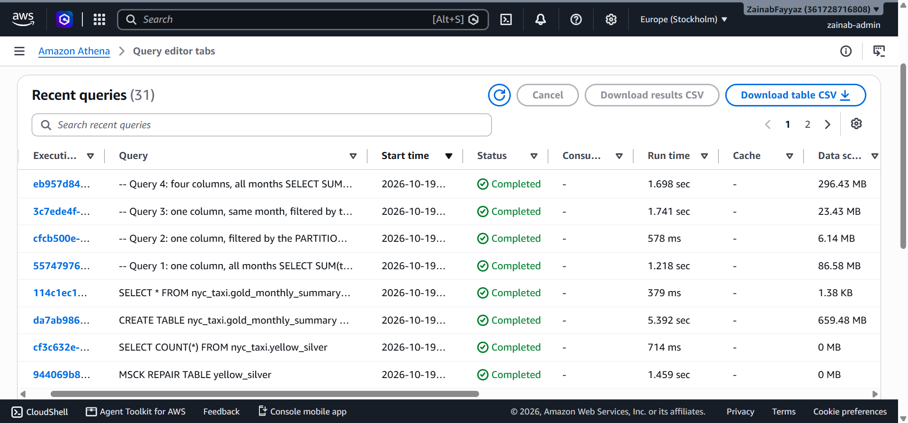
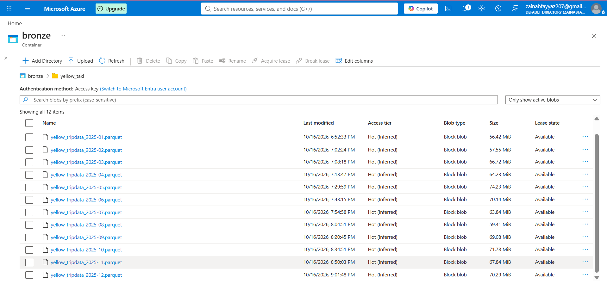

# NYC Taxi Cloud Data Lake

An end-to-end data lake built on the public **NYC Yellow Taxi 2025** data (**48,722,602 trips**, 12 monthly files, 792 MB of raw Parquet). Raw files are stored in **AWS S3**, cleaned and flagged with **Apache Spark** (in Docker), queried with **Amazon Athena**, and mirrored to **Azure Blob Storage**. The data is organised in three layers (bronze, silver, gold), and the project includes a small experiment that measures how file format and partitioning change what Athena scans.

## Architecture



| Layer | What it holds | Where |
|---|---|---|
| Bronze | The 12 raw files, untouched | S3 `bronze/yellow_taxi/` (and the Azure mirror) |
| Silver | Every row, plus 7 true/false quality flags, partitioned by month | S3 `silver/yellow_taxi/` |
| Gold | One row per month with business numbers | S3 `gold/monthly_summary/` |

## Key design decision: flag first, clean later

Silver **keeps all 48,722,602 rows**. Problem rows get a flag column instead of being deleted, so nothing is lost and each analysis chooses what to exclude. The row count after the silver step equals the row count before it.

| Flag | Rule | Rows |
|---|---|---:|
| `is_flex_fare` | `payment_type = 0` (all null-passenger rows have this type) | 11,611,894 |
| `invalid_trip_time` | dropoff earlier than pickup | 2,235 |
| `negative_fare` | `fare_amount < 0` | 2,848,620 |
| `negative_total` | `total_amount < 0` | 973,721 |
| `zero_distance` | `trip_distance = 0` | 1,402,958 |
| `distance_outlier` | `trip_distance > 100` miles | 2,870 |
| `pickup_outside_2025` | pickup year is not 2025 | 29 |

- **The 100-mile threshold is a judgment call.** The maximum distance in the data is 397,994 miles, which is impossible. With the outliers included, the average trip was 6.84 miles against a median of 1.87. The threshold is stored as a flag, so it can be changed without rebuilding the data.
- 81,402 trips have a negative fare but a total that is not negative, which is why `negative_fare` and `negative_total` counts differ.

## Gold: monthly summary

Gold excludes trips flagged `invalid_trip_time` or `pickup_outside_2025`: **2,264 rows** (2,235 + 29, with no overlap). The 12 months add up to **48,720,338** trips, which equals 48,722,602 minus those 2,264, so nothing was lost by accident.

- **Gross revenue** = sum of `total_amount` over trips where `negative_total` is false.
- **Net revenue** = sum of `total_amount` over all included trips, so refunds and reversals reduce it.
- `avg_distance_miles` ignores `distance_outlier` trips. `median_distance_miles` is shown next to it because medians resist outliers.

| Month | Trips | Gross revenue (M USD) | Net revenue (M USD) | Avg distance (mi) | Median distance (mi) | Median duration (min) | Flex fare % |
|---|---:|---:|---:|---:|---:|---:|---:|
| 2025-01 | 3,475,110 | 90.66 | 89.00 | 3.09 | 1.69 | 11 | 15.5 |
| 2025-02 | 3,577,449 | 91.04 | 89.55 | 3.04 | 1.71 | 12 | 22.6 |
| 2025-03 | 4,145,148 | 110.81 | 108.88 | 3.26 | 1.91 | 12 | 22.1 |
| 2025-04 | 3,970,405 | 107.70 | 105.59 | 3.29 | 1.81 | 12 | 18.8 |
| 2025-05 | 4,591,743 | 125.95 | 123.43 | 3.45 | 1.90 | 13 | 26.0 |
| 2025-06 | 4,322,718 | 120.63 | 118.39 | 3.50 | 1.97 | 13 | 28.1 |
| 2025-07 | 3,898,970 | 106.96 | 104.60 | 3.52 | 1.97 | 13 | 26.6 |
| 2025-08 | 3,574,078 | 96.78 | 94.32 | 3.73 | 1.96 | 13 | 24.8 |
| 2025-09 | 4,251,019 | 120.27 | 117.81 | 3.53 | 1.93 | 14 | 25.1 |
| 2025-10 | 4,428,706 | 121.71 | 119.46 | 3.49 | 1.77 | 14 | 22.4 |
| 2025-11 | 4,179,997 | 108.84 | 107.07 | 3.47 | 1.83 | 14 | 24.3 |
| 2025-12 | 4,304,995 | 134.46 | 132.92 | 3.40 | 1.83 | 14 | 27.8 |

What stands out:

- December has the highest revenue (132.9M net). February has the fewest trips, partly because it is the shortest month.
- Average trip duration is above the median every month, because a few very long trips pull the average up.
- The flex-fare share rises from 15.5% in January to 28.1% in June. The data does not say why, so this is an observation, not a conclusion.

## Experiment: what does Athena scan?

Athena charges by the amount of data scanned (about $5 per TB). I ran the same kind of query four ways on the silver table, plus one on a CSV copy of January, and read the scan size from Athena's Recent queries tab.

| # | Query | Data scanned | Run time |
|---|---|---:|---:|
| 1 | 1 column, all months | 86.68 MB | 1.07 s |
| 2 | 1 column, filtered on the **partition** column (January) | 6.14 MB | 0.65 s |
| 3 | 1 column, January, filtered on the **timestamp** column | 23.55 MB | 1.19 s |
| 4 | 4 columns, all months | 296.02 MB | 2.88 s |
| 5 | 1 column, January, from **gzip CSV** | 70.16 MB | not recorded |

- **Column pruning:** Parquet stores each column separately, so asking for 1 column instead of 4 scanned 3.4 times less data (query 1 vs 4).
- **Partition pruning:** filtering on the partition column let Athena skip whole month folders and scan 3.8 times less than filtering on the timestamp (query 2 vs 3).
- **Format:** January, one column, scanned 11 times more as gzip CSV than as Parquet (query 5 vs 2).
- **Caveat:** the CSV copy was gzip-compressed by Athena. Gzip is not splittable, so this compares formats and not just compression.

## Cloud notes (AWS and Azure)

- **AWS (main):** S3 for storage, IAM for access, Athena for SQL. Access uses a dedicated user with a least-privilege policy: list the bucket, read and write objects, and nothing else.
- **Azure (mirror):** the 12 raw files are also copied to an Azure Blob Storage container (verified: 12 data blobs). Azure is used for storage only. All processing and querying run on AWS.
- **No secrets in the repo.** AWS credentials come from a named CLI profile, and the Azure container URL (a temporary SAS token) is read from an environment variable. SAS tokens expire by design.

## Screenshots





## Run it yourself

1. Install Python 3.12+ and Docker. Create a virtual environment and install `requests`, `pandas`, `pyarrow`, `boto3` and `azure-storage-blob`.
2. Download the data (about 792 MB): `py download_data.py`
3. Profile and check it: `py profile_data.py` and `py check_schemas.py`
4. Upload bronze to S3 (needs an AWS profile named `de-pipeline` and your own bucket name in the scripts): `py upload_bronze.py`
5. Build silver with Spark in Docker, then copy the result out of the container (Spark writes inside the container, which avoids crashes on Windows bind mounts):
   ```bash
   bash run_silver.sh
   mkdir -p data/silver
   MSYS_NO_PATHCONV=1 docker cp silver_job:/tmp/silver/yellow_taxi data/silver/
   docker rm silver_job
   ```
6. Upload silver: `py upload_silver.py`
7. In the Athena console, run `athena_queries.sql` in order (create the silver table, repair partitions, build gold).
8. Optional Azure mirror: set `AZURE_CONTAINER_URL`, then `py upload_azure.py` and `py verify_azure.py`.

## Project structure

```text
nyc-taxi-data-lake/
  download_data.py      # downloads the 12 files, checks row counts
  profile_data.py       # looks for nulls, negatives, bad dates
  check_schemas.py      # compares every file's schema to January
  upload_bronze.py      # raw files -> S3 bronze
  silver_clean.py       # Spark: add flags, partition by month
  run_silver.sh         # runs silver_clean.py in Docker
  upload_silver.py      # silver -> S3
  athena_queries.sql    # table, gold build, cost experiment
  upload_azure.py       # raw files -> Azure Blob
  verify_azure.py       # lists and checks the Azure blobs
  test_azure.py         # tiny upload to test the connection
```

## Known limitations and next steps

- Spark runs on one machine in Docker, not on a managed cluster such as EMR or Glue.
- Silver is built from the local raw files. The copy in S3 bronze is the archive and is not read by Spark.
- No scheduler yet. Each step is run by hand. (My Olist project covers Airflow orchestration.)
- Gold has one table. Zone-level and payment-type summaries are natural additions.
- The Athena tables are created by hand from the SQL file, not by code.
- The cause of the rising flex-fare share is not investigated.

## Data attribution

Data: [NYC TLC Trip Record Data](https://www.nyc.gov/site/tlc/about/tlc-trip-record-data.page), Yellow Taxi, January to December 2025. Check the TLC terms of use before reuse. The data is not included in this repo.

Built by Zainab.
